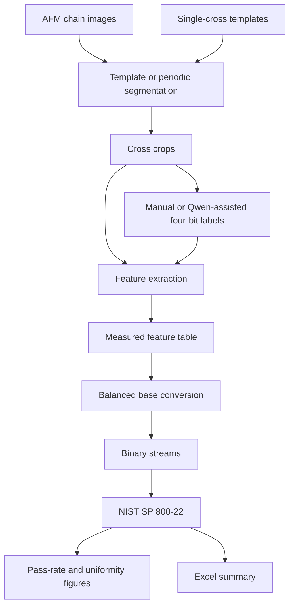

# Multicode Random-Number Pipeline

This document describes the complete workflow from AFM images of linked DNA
origami crosses to NIST SP 800-22 test reports.

## Objective

Each cross contains white streptavidin dots whose positions encode a four-bit
code. The pipeline:

1. splits crosses from AFM chain images;
2. recognizes or assigns the four-bit code for each cross;
3. measures aligned geometric and surface-image features;
4. converts measured features into binary sequences;
5. evaluates the resulting sequences with NIST SP 800-22.

No hash function or pseudo-random expansion is applied in the measurement
pipeline.

## Workflow



## Inputs

| Directory | Content |
| --- | --- |
| `input/multi/` | AFM chain images |
| `input/single/` | One single-cross template per chain image |
| `assets/reference/` | Orientation and random-code rule references |
| `assets/standard/` | Canonical cross geometry |

The pairing rule maps an image name such as `111.png` to template `1.png` and
`aaa.png` to template `a.png`.

## Stage 1: Cross Segmentation

### Template matching

Straight chains are segmented with normalized cross-correlation:

- method: `cv2.matchTemplate`;
- score: `TM_CCOEFF_NORMED`;
- threshold: 0.30;
- non-maximum-suppression radius: 0.75 times the template short side;
- maximum detections: 40.

`segment_chains.py` implements this method.

### Periodic segmentation

Curved chains require a period-aware method:

1. compute a column projection of the foreground mask;
2. estimate the cross period by autocorrelation;
3. refine boundaries at local minima;
4. reject fragments shorter than 45% of the template width.

`compare_segmentation.py` and `segment_period_centers.py` implement the periodic
workflow.

### Combined segmentation

`segment_union.py` uses high-confidence template boxes and applies periodic
segmentation only where templates do not cover the chain.

## Stage 2: Four-Bit Recognition

`pipeline.py` and `recognize_crops.py` support a Qwen-compatible vision model.

Recommended inference settings:

| Parameter | Value |
| --- | --- |
| Model | Provider-selected Qwen vision model |
| Temperature | 0 |
| Timeout | 240-600 s |
| Retries | 2-3 |
| Thinking mode | Enabled when supported |

The model receives:

- the cropped cross image;
- the English orientation and mapping reference;
- an instruction to return strict JSON.

Expected output:

```json
{
  "image": ".../cross_01.png",
  "cross_index": 1,
  "code": "1001",
  "confidence": 0.72
}
```

Manual labels can be merged into the same `merged_results.json` schema.

## Stage 3: Feature Extraction

`cross_features_v2.py` and `dot_features.py` perform:

1. Otsu thresholding and connected-component localization of the cross;
2. expected-site projection from canonical coordinates;
3. difference-of-Gaussians peak detection near expected sites;
4. sub-pixel quadratic fitting;
5. similarity alignment by scale, rotation, and translation;
6. residual and morphology measurement.

### Feature groups

| Group | Count | Examples |
| --- | ---: | --- |
| White-dot features | 21 | residual `dx`/`dy`, contrast, area, DoG response, RMS |
| Cross geometry | 26 | scale, orientation, area, convexity, arm lengths, angles |
| Surface features | 15 | percentiles, roughness, tilt, background statistics |

The nominal feature dimension is 62. In the final 253-cross dataset, 26
orthogonal principal directions explain 95% of the feature variance. An
earlier 16-cross subset required only 11 directions, showing that the
effective dimension is sample-dependent. Both the nominal feature count and
the measured effective dimension should be reported separately.

## Stage 4: Measurement-to-Bit Encoding

Direct float64-to-binary conversion is not used because leading zeros and fixed
exponent bits create constant positions and severe 0/1 imbalance.

For each feature vector:

1. concatenate the shortest exact decimal representation of every feature;
2. interpret the resulting digit string as an integer `D`;
3. for string length `L`, produce
   `N = floor(L * log2(10))` bits;
4. map to binary as
   `b = floor(D * 2^N / 10^L)`.

The conversion introduces no padding and carries approximately 3.32 bits per
decimal digit.

For the validated reference run:

| Quantity | Value |
| --- | ---: |
| Crosses | 266 |
| Bits before exclusion | 721,772 |
| Crosses after excluding `ccc` | 253 |
| Bits after exclusion | 686,265 |
| Ones ratio | 0.4995 |
| Lag-1 autocorrelation | 0.0015 |

## Stage 5: NIST SP 800-22

Generate streams at the AFM-image level rather than by arbitrary bit slicing.
All crosses from one source image remain in the same group.

The validated partition excludes `ccc` and divides the remaining images into
three non-overlapping groups:

| Group | Images | Crosses | Bits |
| --- | ---: | ---: | ---: |
| Part 1 | 10 | 84 | 228,209 |
| Part 2 | 11 | 80 | 216,918 |
| Part 3 | 12 | 89 | 241,138 |

The combined stream contains 253 crosses and 686,265 bits, divided into 56
sequences of 12,254 bits.

Recommended settings:

| Parameter | Value |
| --- | --- |
| Engine | Official NIST STS C implementation |
| Number of sequences | 56 |
| Significance level | 0.01 |
| p-value uniformity threshold | 0.001 |
| Passing proportion | Greater than 52/56 |
| Approximate-entropy block length | 4 |
| Serial block length | 8 |
| Rank test | Full stream, one sequence |

The shorter block lengths are required for these sequence lengths. Default
settings produce too few expected pattern counts, causing false failures.

## Commands

Run from `multicodes/`:

```bash
python src/segment_period_centers.py --groups aaa bbb ccc
python src/recognize_crops.py --groups aaa --retries 2 --timeout 600 --skip-existing
python src/build_all_features.py
python src/build_random_stream.py --order interleave --exclude ccc
python src/test_by_image_partition.py \
  --partition outputs/qwen_recognition/final/image_partition_final.json \
  --work outputs/qwen_recognition/final/image_partition_final \
  --prefix finalpart
python src/plot_nist_charts.py --prefix combined
```

## Key Scripts

| Script | Function |
| --- | --- |
| `src/pipeline.py` | End-to-end segmentation and recognition |
| `src/recognize_crops.py` | Batch recognition with resume support |
| `src/segment_chains.py` | Template-matching segmentation |
| `src/segment_period_centers.py` | Periodic center-window segmentation |
| `src/segment_union.py` | Combined template and periodic segmentation |
| `src/cross_features_v2.py` | Extended feature extraction |
| `src/build_all_features.py` | Batch feature generation |
| `src/build_random_stream.py` | Measurement-to-bit encoding |
| `src/run_official_sts.py` | Official STS wrapper |
| `src/test_by_image_partition.py` | Source-image-partition testing |
| `src/plot_nist_charts.py` | Publication figures |
| `src/export_excel.py` | Consolidated result tables |

## Reproducibility Notes

- Preserve source-image identifiers and group assignments.
- Do not choose thresholds from the final test stream.
- Document exact NIST STS versions and parameters.
- Keep measurement-derived bits separate from deterministic expansion.
- Report failures rather than tuning until they disappear.
