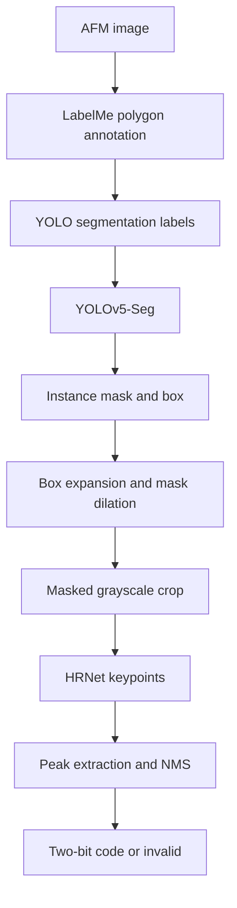

# Dimer YOLO and HRNet Methods

This document describes the two-stage dimer recognition workflow.

## Pipeline



## Dataset

Three classes are used:

| ID | Class | Meaning |
| ---: | --- | --- |
| 0 | `dimmer` | Complete dimer |
| 1 | `monomer` | Monomer or fragment |
| 2 | `invalid` | Incomplete or unreadable structure |

## Stage 1: Instance Segmentation

### Model

- initialization: COCO-pretrained YOLOv5s-Seg;
- input size: 640 x 640;
- batch size: 4 or the largest stable value for available memory;
- epochs: 500 for the reference run;
- freeze: first 10 layers;
- early-stopping patience: 30.

The detector predicts one polygon mask and one class per instance.

### Inference

1. discard detections below the configured confidence threshold;
2. suppress duplicate boxes with NMS;
3. expand each box by the configured ratio and minimum pixel margin;
4. rasterize the polygon mask;
5. dilate the mask;
6. apply the mask to the grayscale crop.

Expansion and dilation are important because peripheral white dots may fall
outside the tight segmentation boundary.

## Stage 2: HRNet Keypoints

Four heatmaps are predicted:

```text
left_dot_1
left_dot_2
right_dot_1
right_dot_2
```

Recommended reference settings:

| Parameter | Value |
| --- | --- |
| Input | 256 x 256 grayscale |
| Heatmap size | 64 x 64 |
| Gaussian sigma | 3 |
| Optimizer | Adam |
| Learning rate | 1e-4 |
| Weight decay | 1e-4 |
| Scheduler | CosineAnnealingLR |
| Batch size | 4 |
| Epochs | 100 |
| AMP | Enabled on CUDA |

Peaks are decoded with a heatmap threshold and a non-maximum-suppression
distance. A missing point invalidates the instance.

## Two-Bit Assignment

For each side, the Euclidean distance between its two accepted points is
measured in the normalized 256 x 256 crop coordinate system.

```text
bit = 1 when distance < threshold
bit = 0 otherwise
```

The left-side bit is first and the right-side bit is second.

The threshold must be selected on the training or validation data and frozen
before independent testing.

## Evaluation

### PCK

Percentage of correct keypoints:

```text
PCK = mean(distance(predicted, ground_truth) < tau * image_diagonal)
```

### OKS

COCO-style object keypoint similarity:

```text
OKS = mean(exp(-d^2 / (2 * sigma^2 * area)))
```

Report visible keypoint counts and the definition used for missing points.

### Segmentation

Report:

- precision;
- recall;
- F1;
- box mAP;
- mask mAP;
- per-class confusion matrix.

## Data Splitting

Split by source AFM image. Crops and augmented copies derived from one source
image must not cross train, validation, and test boundaries.

## Reproducibility

Archive:

- resolved YAML files;
- source-image split lists;
- weight checksums;
- software versions;
- random seed;
- keypoint and code thresholds;
- evaluation code and output tables.
